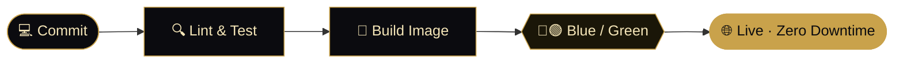

<!-- ═══════════════ HERO ═══════════════ -->

<!--  -->

<!--    -->

 

<!-- ═══════════════ ABOUT ═══════════════ -->
<h2 align="center">◆ &nbsp;ABOUT&nbsp; ◆</h2>

I design and engineer <b>responsive, scalable web applications</b> where polished UI/UX meets disciplined engineering. 
From the first wireframe to the production pipeline, I own the full journey.

<table align="center">
  <tr>
    <td align="center" width="25%"><h3>🎨</h3><b>Front-End</b> React · Next.js Pixel-precise, accessible UI</td>
    <td align="center" width="25%"><h3>⚙️</h3><b>Back-End</b> Node · Express · NestJS Clean, secure REST APIs</td>
    <td align="center" width="25%"><h3>🗄️</h3><b>Data</b> MongoDB · MySQL · SQL Server The right model for the job</td>
    <td align="center" width="25%"><h3>🚀</h3><b>Delivery</b> Docker · CI/CD · Nginx Automated, repeatable releases</td>
  </tr>
</table>

 

<!-- ═══════════════ STACK ═══════════════ -->
<h2 align="center">◆ &nbsp;TECH STACK&nbsp; ◆</h2>

**Front-End** 

**Back-End** 

**Databases &nbsp;·&nbsp; NoSQL & SQL** 

**DevOps · Cloud · CI/CD** 

**Tooling** 

 

<!-- ═══════════════ PIPELINE ═══════════════ -->
<h2 align="center">◆ &nbsp;ENGINEERING WORKFLOW&nbsp; ◆</h2>

<table align="center">
  <tr>
    <td width="33%" valign="top"><b>⚡ Continuous Integration</b> Push-triggered linting, tests and builds so every commit is verified before it merges.</td>
    <td width="33%" valign="top"><b>🔁 Zero-Downtime Deploys</b> Blue/green releases with process management (PM2) and webhook-triggered pipelines.</td>
    <td width="33%" valign="top"><b>📦 Reproducible Environments</b> Docker-based builds and Nginx reverse proxying for consistent staging and production.</td>
  </tr>
</table>

 

<!-- ═══════════════ PROJECTS ═══════════════ -->
<h2 align="center">◆ &nbsp;SELECTED WORK&nbsp; ◆</h2>

<table align="center">
  <tr>
    <td width="50%" valign="top">
      <h3>🏠 Real Estate Platform</h3>
      Full-stack property platform with listings and secure authentication.  
      
    </td>
    <td width="50%" valign="top">
      <h3>📦 easyGco</h3>
      All-in-one e-commerce solution: launch a store fast and accept 300+ payment methods.  
      
    </td>
  </tr>
  <tr>
    <td width="50%" valign="top">
      <h3>✨ UpWall</h3>
      App growth platform page: user acquisition, onboarding, monetization and real-time analytics.  
      
    </td>
    <td width="50%" valign="top">
      <h3>🦷 Dentist Landing</h3>
      A clean, informative landing page tailored for a dental professional.  
      
    </td>
  </tr>
</table>

<!-- Tip: add a line like "<code>React</code> · <code>Node</code> · <code>MongoDB</code>" under each description once confirmed. -->

 

<!-- ═══════════════ STATS ═══════════════ -->
<h2 align="center">◆ &nbsp;GITHUB ANALYTICS&nbsp; ◆</h2>

  
  
   
  

 

<!-- ═══════════════ CONTACT ═══════════════ -->
<h2 align="center">◆ &nbsp;LET'S BUILD SOMETHING EXCEPTIONAL&nbsp; ◆</h2>

Open to collaborations, freelance projects and full-time opportunities. 
<a href="https://linkedin.com/in/mohamed-nasr-1682ab239"><b>LinkedIn</b></a> &nbsp;·&nbsp;
<a href="https://YOUR_PORTFOLIO.com"><b>Portfolio</b></a> &nbsp;·&nbsp;
<a href="mailto:YOUR_EMAIL"><b>Email</b></a>

