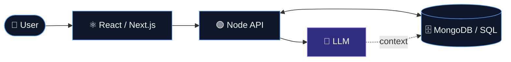
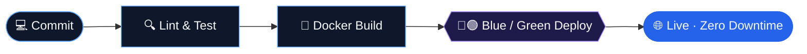

<!-- ═══════════════ HERO ═══════════════ -->
<div align="center">


<a href="https://git.io/typing-svg"></a>

<br/><br/>

<a href="https://linkedin.com/in/mohamed-nasr-1682ab239"></a>
<a href="https://YOUR_PORTFOLIO.com"></a>
<a href="mailto:YOUR_EMAIL"></a>


</div>

<br/>

<!-- ═══════════════ ABOUT ═══════════════ -->
## 👋 About

I'm a **Full-Stack Engineer** who builds responsive, scalable web applications on the **MERN stack**, and I use **AI** to make products smarter and my own workflow faster. I care about clean architecture, great UX, and software that is reliable all the way into production.

```ts
const mohamed = {
  role: "Full-Stack Engineer",
  stack: ["MongoDB", "Express", "React", "Next.js", "Node.js", "NestJS"],
  databases: { nosql: ["MongoDB", "Firebase"], sql: ["MySQL", "SQL Server"] },
  ai: ["LLM API integration", "Prompt engineering", "RAG pipelines", "AI-assisted development"],
  delivery: ["Docker", "GitHub Actions", "Nginx", "AWS", "Azure"],
  principle: "Ship maintainable code that users actually enjoy.",
};
```

<br/>

<!-- ═══════════════ WHAT I DO ═══════════════ -->
## 🎯 What I Do

<table>
  <tr>
    <td width="25%" valign="top"><h3>🎨 Front-End</h3><sub>Responsive, accessible interfaces with React and Next.js, built with a design-first mindset.</sub></td>
    <td width="25%" valign="top"><h3>⚙️ Back-End</h3><sub>Secure, well-structured REST APIs with Node.js, Express and NestJS.</sub></td>
    <td width="25%" valign="top"><h3>🗄️ Data</h3><sub>Document and relational modeling across MongoDB, MySQL and SQL Server.</sub></td>
    <td width="25%" valign="top"><h3>🤖 AI</h3><sub>LLM-powered features: chat, summarization, search and automation inside real apps.</sub></td>
  </tr>
</table>

<br/>

<!-- ═══════════════ STACK ═══════════════ -->
## 🛠 Tech Stack

| | |
| :-- | :-- |
| **Front-End** |  |
| **Back-End** |  |
| **NoSQL & SQL** |  |
| **DevOps & Cloud** |  |
| **Tooling** |  |

<br/>

<!-- ═══════════════ AI ═══════════════ -->
## 🤖 AI Engineering

I treat AI as a product feature and a productivity multiplier, never a gimmick.

| Capability | What it means in practice |
| :-- | :-- |
| **LLM API Integration** | Connecting hosted models to Node.js back-ends with streaming responses, error handling and cost control |
| **Prompt Engineering** | Structured prompts, system instructions and output schemas for consistent, parseable results |
| **RAG & Semantic Search** | Grounding answers in your own data with embeddings and a vector or document store |
| **AI Automation** | Turning repetitive workflows into assisted flows: classification, summarization, drafting |
| **AI-Assisted Development** | Using AI tools for code review, refactoring, tests and documentation to ship faster with quality |



<br/>

<!-- ═══════════════ CI/CD ═══════════════ -->
## 🔄 Engineering Workflow



- ⚡ **Continuous integration:** automated linting, tests and builds on every push
- 🔁 **Zero-downtime releases:** blue/green deployments with PM2 and webhook-triggered pipelines
- 📦 **Consistent environments:** Docker builds and Nginx reverse proxying from staging to production

<br/>

<!-- ═══════════════ PROJECTS ═══════════════ -->
## 📌 Featured Projects

| Project | Overview | Link |
| :-- | :-- | :-: |
| 🏠 **Real Estate Platform** | Full-stack property platform with listings and secure authentication | [View →](https://github.com/Mo7amed-Nasr-78/realEstates_platform) |
| 📦 **easyGco** | All-in-one e-commerce solution: launch a store quickly and accept 300+ payment methods | [View →](https://github.com/Mo7amed-Nasr-78/easyGco) |
| ✨ **UpWall** | App growth platform page covering acquisition, onboarding, monetization and real-time analytics | [View →](https://github.com/Mo7amed-Nasr-78/upWall-Landing) |
| 🦷 **Dentist Landing** | Clean, informative landing page tailored for a dental professional | [View →](https://github.com/Mo7amed-Nasr-78/Dentist-Landing) |

<!-- Tip: add a "Stack" column (e.g. React · Node · MongoDB) once confirmed, and an AI project here when ready. -->

<br/>

<!-- ═══════════════ STATS ═══════════════ -->
## 📊 GitHub Analytics

<div align="center">
  
  
  <br/>
  
</div>

<br/>

<!-- ═══════════════ CONTACT ═══════════════ -->
## 🤝 Let's Work Together

Open to collaborations, freelance work and full-time roles, especially on products that combine solid web engineering with practical AI.

<p>
  <a href="https://linkedin.com/in/mohamed-nasr-1682ab239"></a>
  <a href="https://YOUR_PORTFOLIO.com"></a>
  <a href="mailto:YOUR_EMAIL"></a>
</p>


